<div align="center">


# Kiorly Pharmacy

**A complete pharmacy management system for Egypt and the region.**
Lot-accurate inventory, pharmacist-gated dispensing, a fast offline-tolerant POS, supplier automation and 32 reports. It runs fully on its own; connecting it to Kiorex is one optional setting.


[At a glance](#at-a-glance) · [Standalone vs Integrated](#standalone-vs-integrated) · [Features](#features) · [Architecture](#architecture) · [Screens](#screens) · [Plans](#plans-and-entitlements) · [Quick start](#quick-start) · [Tests](#tests) · [Docs](#where-to-read-next)

</div>

> **Synthetic data only.** Demo logins, URLs and reset steps: [Docs/TEST_DATA.md](Docs/TEST_DATA.md) (DEV ONLY, blocked in production).

---

## What and why

Kiorly Pharmacy is operating software for independent pharmacies and small chains. A pharmacist verifies a prescription, nine clinical safety checks run, a licensed pharmacist signs, and only then does the system dispense from the **first-expiring safe lot**; expired, recalled or quarantined stock can never be sold, enforced in the service **and** by database triggers. Around that core sit a touch-first POS with split payments and returns, purchasing with RFQ and goods receipt, a controlled-substance register with a running balance, loyalty and credit for customers, finance, and a notifications centre. It is a **complete standalone pharmacy system** (all ten areas of the [feature matrix](Docs/FEATURE_MATRIX.md)); when a pharmacy wants Kiorex patient orders it flips one setting and the same product starts talking to Kiorex over HMAC REST and outbox webhooks.

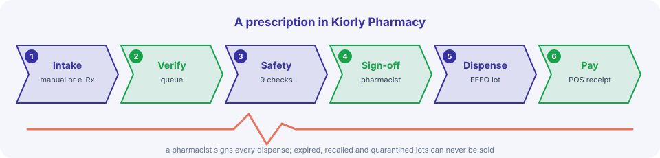

## At a glance

| | |
|---|---|
| **Product** | Kiorly Pharmacy by Kiorex (accent Pharmacy Green `#16A34A`); part of the Kiorly provider suite next to Kiorly Clinic and Kiorly Lab |
| **API** | NestJS 12 + Prisma 7 + PostgreSQL 16, `:3100`, prefix `/api/v1`, Swagger at `/docs`, 78 Prisma models, 25 enums, 15 migrations |
| **Web** | React 19 + Vite 8 + Tailwind 4 + TanStack Query + i18next (Arabic and English, RTL), Vite `:5190`, installable POS PWA |
| **Roles** | `OWNER`, `PHARMACIST`, `CASHIER`, `ASSISTANT`, `BRANCH_MANAGER`, `CHAIN_OPS` with per-tenant overrides |
| **Editions** | Lite, Pro, Chain, Enterprise (see [Plans](#plans-and-entitlements)) |
| **Mode** | `STANDALONE` (default for new pharmacies) or `INTEGRATED` with Kiorex |
| **Identity** | Local dev JWT, or Kiorex Passport OIDC (`AUTH_MODE=oidc`, audience `kiorly-pharmacy`, MFA for privileged roles in production) |
| **Mobile** | A Kiorly mobile app (design in progress, see [Docs/MOBILE.md](Docs/MOBILE.md)) |
| **Providers** | All mocked (`MODE=mock`): PSP, messaging, storage, push, Kiorex |
| **Standing rule** | No tax-authority reporting, ever (ADR-011). VAT is a display and export line only; a CI test enforces it |

## Standalone vs Integrated

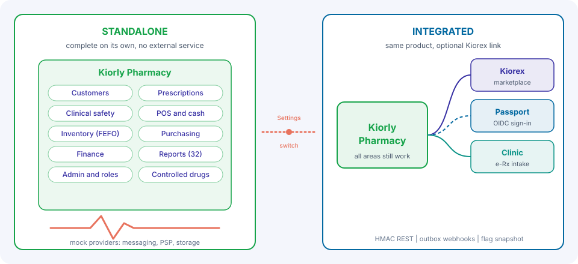

| | **STANDALONE** | **INTEGRATED** |
|---|---|---|
| Set by | `Tenant.settings.mode = "STANDALONE"` (signup default) | `mode = "INTEGRATED"`, or unset on a tenant with an active `IntegrationClient` |
| Kiorex orders, machine API `/marketplace/v1`, inbound webhook, outbox events | Off: `403 STANDALONE_MODE` | On (still gated by flag `pharmacy.kiorex_orders`) |
| `/auth/me` | `tenant.mode = "STANDALONE"`, Kiorex orders hidden in the UI | `tenant.mode = "INTEGRATED"` |
| The ten core areas, optional e-Rx intake, loyalty, claims, reports | Work | Work |
| Safety controls (ADR-025) | Identical | Identical |

Switch in **Settings > General** (owner only) or `PATCH /api/v1/settings {mode}`; read it at `GET /api/v1/admin/mode`. Switching back to standalone stops order ingest and outbox events immediately and keeps all data. Details and the registration steps: [Docs/RUNBOOK.md](Docs/RUNBOOK.md).

## Features

Status is taken from [Docs/FEATURE_MATRIX.md](Docs/FEATURE_MATRIX.md): :white_check_mark: = backend, UI, tests and seed all done.

| # | Area | What you get | Status |
|---|---|---|---|
| 1 | **Customers** | Registry, profile, allergies and conditions, history, family links, notes, consent, loyalty tiers, credit accounts, merge, search | :white_check_mark: |
| 2 | **Prescriptions** | Manual entry, prescribers, refills with reminders, partial fills, transfer in and out, optional e-Rx, verification queue, substitution, labels, counselling | :white_check_mark: |
| 3 | **Clinical safety** | Nine checks (interaction, allergy, duplicate, dose range, pregnancy and lactation, renal, hepatic), pluggable knowledge base, override with reason and audit; controlled register with running balance, witness and discrepancies | :white_check_mark: knowledge base is synthetic (NH-PH-040) |
| 4 | **POS and cash** | Promotions, coupons, bundles, price book and history, VAT lines, split payments, held carts, returns and exchanges, thermal and A4 receipts, shifts, drawer, X/Z, offline queue | :white_check_mark: offline applies no promotions or loyalty redemption |
| 5 | **Inventory** | Lots and FEFO, min/max and reorder, counts, adjustments, write-offs, transfers, cold chain, recalls, labels and barcodes, movers and dead stock, shelf locations, pack units | :white_check_mark: |
| 6 | **Purchasing** | RFQ and PO lifecycle, goods receipt, supplier returns, ledger, payments and aging, cost variance, auto-reorder | :white_check_mark: |
| 7 | **Finance** | Daily sales, margin, payments by method, expenses, payables, receivables, insurer claims, CSV and PDF | :white_check_mark: PDF is print-to-PDF of HTML views |
| 8 | **Admin** | Staff and role matrix, branches, settings (receipt, printers, tax display, currency, languages), audit viewer, CSV import, export and backup, notifications | :white_check_mark: |
| 9 | **Reports** | Dashboard plus 32 reports in 6 groups | :white_check_mark: |
| 10 | **Kiorex link** | Optional marketplace orders; standalone is first-class | :white_check_mark: |
| - | **Provider go-live** | Real PSP, messaging, push, hardware | :hourglass_flowing_sand: [NEEDS_HUMAN](Docs/NEEDS_HUMAN.md) |

<details>
<summary><b>Deep dive: dispensing, safety and the controlled register</b></summary>

- **Dispense** needs a pharmacist user and timestamp: a database `CHECK` (`dispensing_requires_signoff`) plus the service. Cashiers and assistants can prepare but not sign.
- **Safety checks** run on every Rx. An override needs a reason and is audited; the knowledge base is a synthetic starter set plus tenant rules (`/clinical/kb`) and must be reviewed by a licensed pharmacist before clinical use.
- **Controlled drugs**: every movement writes a `ControlledRegisterEntry` with a running balance. Adjustments, write-offs, returns, count variances and transfers need a **witness** (a different active staff member's credentials). Periodic audits create discrepancy records that must be resolved with a reason. Controlled data is never exposed to Kiorex ordering.
- **Lots**: `kx_enforce_lot_sellable` and the recall service block sale of expired, recalled (across branches within 5 minutes) and quarantined lots; cold-chain excursions quarantine stock.
</details>

<details>
<summary><b>Deep dive: offline POS</b></summary>

The POS is a PWA with an IndexedDB queue and a service worker. Sales made offline sync through `/pos/sync` with a conflict API; promotions and loyalty redemption are not applied offline. Playwright covers the offline reconcile flow (`apps/web/e2e/pos-offline.spec.ts`).
</details>

## Architecture

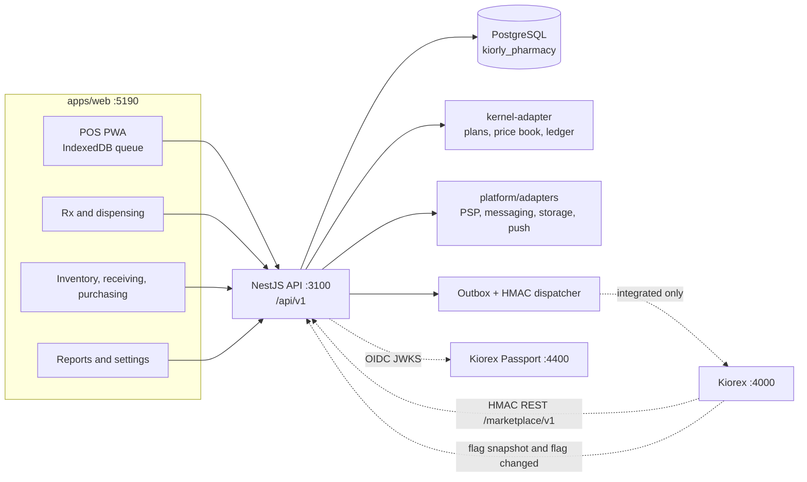

Cross-cutting modules: `auth` (permissions, never roles, guard every route), `audit`, `outbox`, `kernel-adapter` (seam for `@kiorly/commerce-kernel`), `platform/adapters` (mock or real providers), `feature-flags`. Domain modules: `catalogue`, `inventory`, `prescriptions`, `clinical`, `controlled`, `dispensing`, `pos`, `customers`, `suppliers`, `purchasing`, `finance`, `claims`, `forecasting`, `reports`, `dashboard`, `marketplace`, `admin`, `mobile`.

### Key flow: prescription to dispense

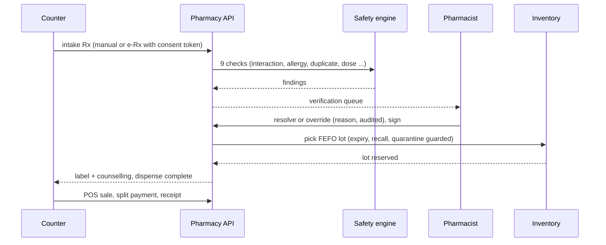

### Data model overview

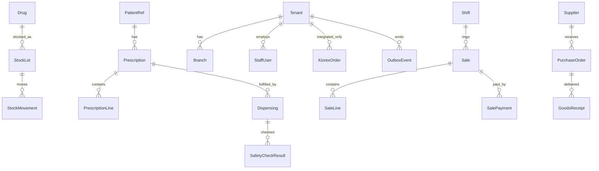

78 models in [`apps/api/prisma/schema.prisma`](apps/api/prisma/schema.prisma) (schema FROZEN-v1; discovery-dependent defaults are marked NEEDS_HUMAN). Database invariants (lot sellability, sign-off, append-only ledgers) are triggers in the migrations.

### Roles and permissions

Guards check **permissions**, never roles. Owner edits create `RolePermissionOverride` rows (cached 15 s); the Owner role and locked safety permissions (`dispense.signoff`, `controlled.read`, `controlled.manage`, `roles.manage`, `staff.manage`) cannot be changed. Settings > Roles shows the live matrix.

| Capability | Owner | Pharmacist | Cashier | Assistant | Branch manager | Chain ops |
|---|:-:|:-:|:-:|:-:|:-:|:-:|
| Sell at the POS, run a shift | :white_check_mark: | :white_check_mark: | :white_check_mark: | :white_check_mark: | :white_check_mark: | |
| Intake a prescription | :white_check_mark: | :white_check_mark: | | :white_check_mark: | :white_check_mark: | |
| **Sign a dispense** (locked) | :white_check_mark: | :white_check_mark: | | | | |
| Approve refunds | :white_check_mark: | :white_check_mark: | | | :white_check_mark: | |
| Receive and count stock | :white_check_mark: | :white_check_mark: | | :white_check_mark: | :white_check_mark: | |
| Purchase orders, supplier write | :white_check_mark: | | | | :white_check_mark: | :white_check_mark: |
| Inter-branch transfer | :white_check_mark: | | | | :white_check_mark: | :white_check_mark: |
| Reports | :white_check_mark: | :white_check_mark: | | | :white_check_mark: | :white_check_mark: |
| Staff, roles, settings write | :white_check_mark: | | | | | |

Privileged roles (owner, branch manager, chain ops, pharmacist) must present an MFA claim in production.

## Screens

Captured from the running app with synthetic data (English, light theme first, then Arabic RTL and dark). The full before and after sets are in the workspace `_docs/ui-review/pharmacy/`.

| Dashboard | POS | Prescriptions |
|---|---|---|
| 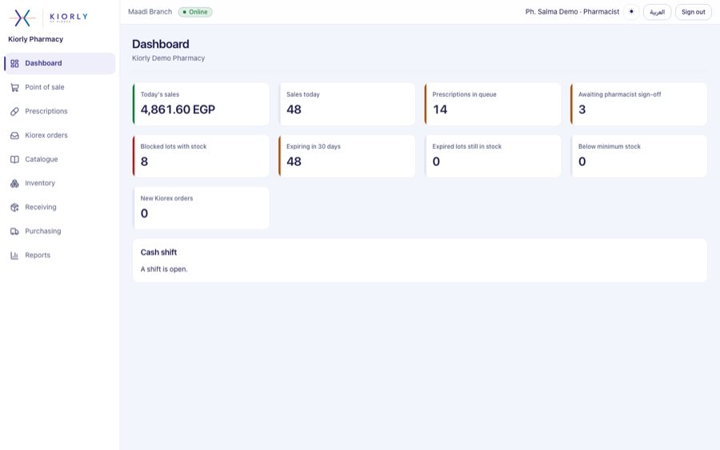 | 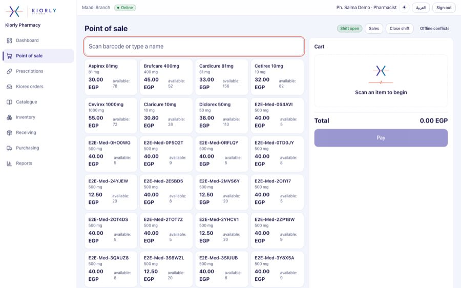 | 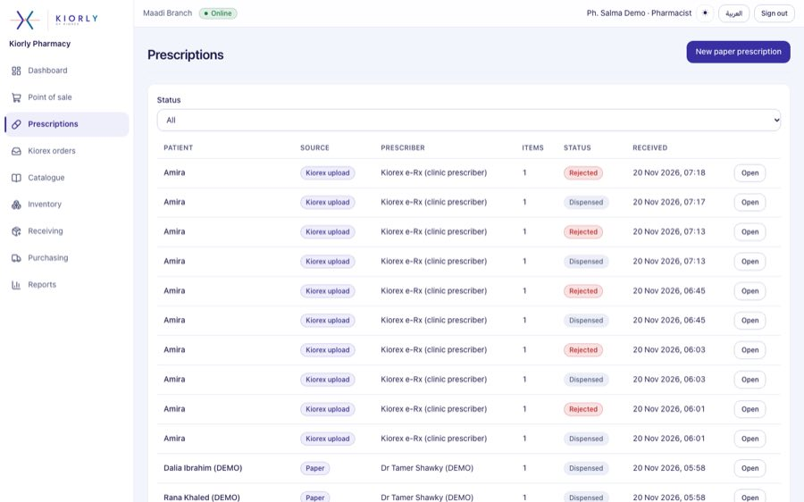 |

| Inventory | Kiorex orders | Reports |
|---|---|---|
| 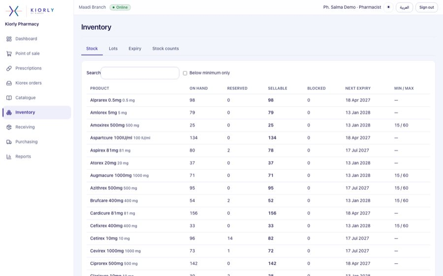 | 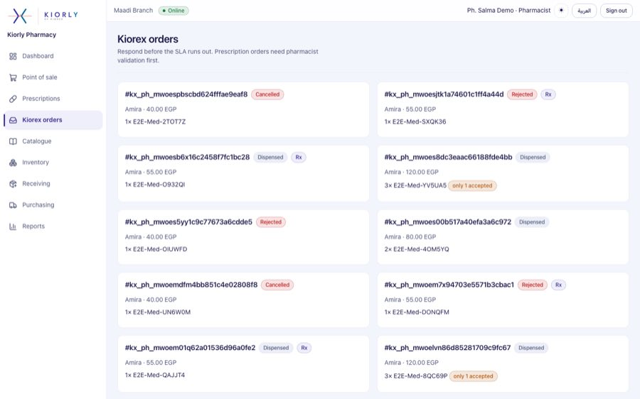 | 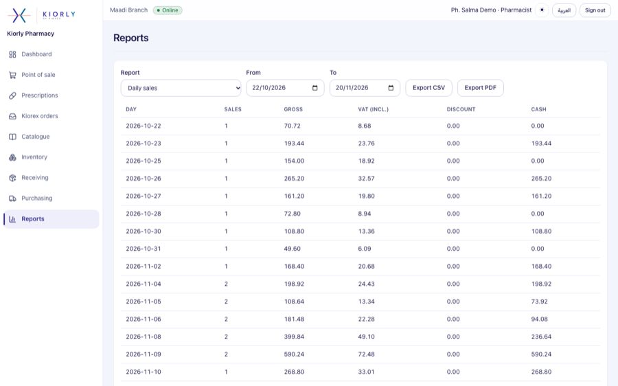 |

| Catalogue | Arabic dashboard (RTL) | Arabic POS (RTL) |
|---|---|---|
| 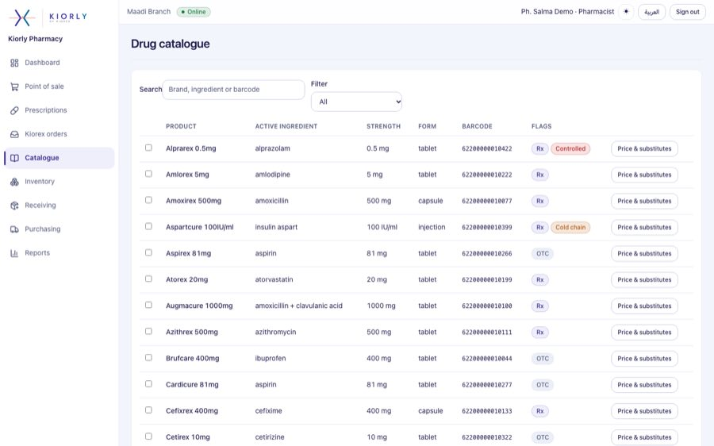 | 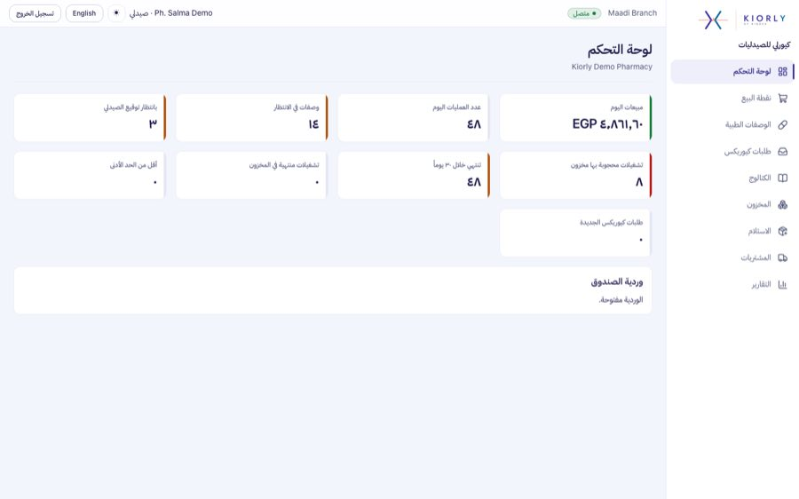 | 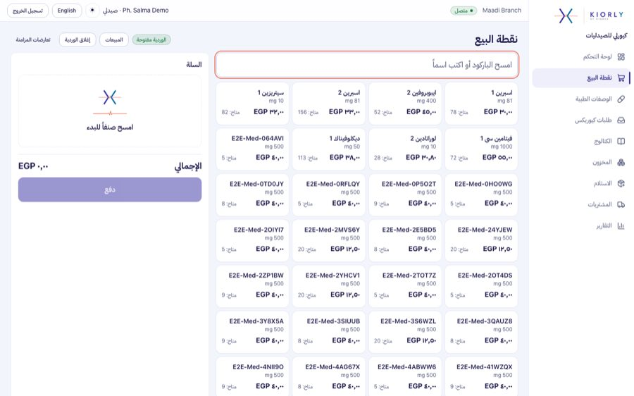 |

| Dark theme | Sign in |
|---|---|
| 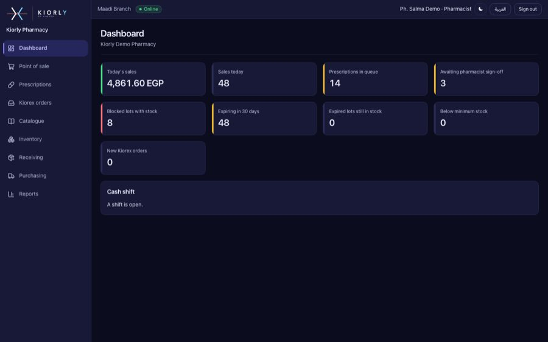 | 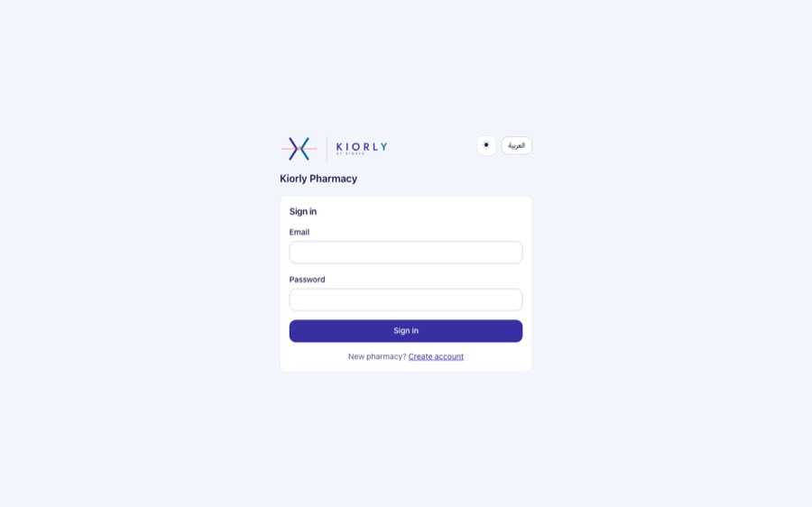 |

## Plans and entitlements

From `apps/api/src/kernel-adapter/local/local-kernel.ts` (KX-06 §02). Safety controls are in **every** edition and are not capabilities. Prices are not decided here (NEEDS_HUMAN). A `SUSPENDED` subscription turns all capabilities off. Plan gates answer `402 ENTITLEMENT_REQUIRED`; feature flags are separate and answer `403 FEATURE_DISABLED`.

| | Lite | Pro | Chain | Enterprise |
|---|:-:|:-:|:-:|:-:|
| Users | 2 | 5 | Unlimited | Unlimited |
| Branches | 1 | Unlimited | Unlimited | Unlimited |
| Kiorex orders (`kiorex_orders`) | :white_check_mark: | :white_check_mark: | :white_check_mark: | :white_check_mark: |
| Purchasing | | :white_check_mark: | :white_check_mark: | :white_check_mark: |
| Forecasting | | :white_check_mark: | :white_check_mark: | :white_check_mark: |
| Insurer claims | | add-on | :white_check_mark: | :white_check_mark: |
| Inter-branch transfers | | | :white_check_mark: | :white_check_mark: |
| Central price book | | | :white_check_mark: | :white_check_mark: |

<details>
<summary><b>Feature flags and safety controls</b></summary>

Flags are evaluated locally from the Kiorex snapshot with `@kiorex/contracts` (`GET /control/v1/flags/snapshot?product=kiorly-pharmacy`, polled every 30 s when `FLAGS_POLL_ENABLED=true`, cached in `FlagSnapshotCache`, refreshed by the signed `flag.changed` webhook). No snapshot means code defaults: ON, launch-locked OFF. Keys: `pharmacy.module`, `pharmacy.kiorex_orders`, `pharmacy.forecasting`, `pharmacy.insurer_claims`. OFF answers `403 FEATURE_DISABLED {key, scope}` and never hides data.

**Safety controls are never flags** (ADR-025): lot expiry, recall and quarantine blocks; Rx safety checks; pharmacist sign-off; controlled-substance log; consent enforcement; audit; tenant isolation; privileged MFA. A CI test fails if safety-path code references a flag. Table: [Docs/ADR_REFERENCE.md](Docs/ADR_REFERENCE.md).
</details>

### Stack versions (upgraded 20 Nov 2026)

| Layer | Version |
|---|---|
| Runtime | Node.js 26 LTS (`.nvmrc`), npm 11+, Lambda `nodejs24.x` |
| Language | TypeScript 6.0 |
| API | NestJS 12, `@nestjs/swagger` 12, Express 5, class-validator 0.15, jose 6, pdfkit 0.21 |
| Data | Prisma 7 (`prisma-client` generator, `@prisma/adapter-pg`), PostgreSQL 16 |
| Web | React 19, Vite 8, Tailwind CSS 4, TanStack Query 5, i18next 27, react-i18next 18 |
| Tooling | ESLint 9.39, typescript-eslint 8, Playwright 1.65, tsx, swc (test runner) |

Upgrade log, pinned items and what unblocks them: [Docs/UPGRADE_NOTES.md](Docs/UPGRADE_NOTES.md).

## Quick start

Prerequisites: Node 26 LTS (`nvm use`, see `.nvmrc`) and npm 11+, the workspace Postgres on `:5433` (see the workspace [README](https://github.com/mshall/kiorex-workspace)), and the sibling `../kiorex-contracts/dist-pack/kiorex-contracts-1.2.0.tgz`.

```bash
npm install
cp .env.example apps/api/.env        # DATABASE_URL points to kiorly_pharmacy on :5433; never commit .env
npm run prisma:generate -w api      # Prisma 7 client -> apps/api/src/generated (gitignored)
npm run db:setup                     # creates kiorly_pharmacy + kiorly_pharmacy_test, applies migrations
npm run seed -w api                  # synthetic catalogue + demo tenant (idempotent)
npm run dev                          # API :3100 + web :5190
```

| Service | URL | Notes |
|---|---|---|
| API | http://localhost:3100/api/v1 | `/health/live`, `/health/ready`, Swagger at `/docs`, machine API for Kiorex at `/marketplace/v1` |
| Web | http://localhost:5190 | proxies `/api` to 3100; language switch top right (Arabic is RTL) |
| Database | `127.0.0.1:5433` | `kiorly_pharmacy` (tests use `kiorly_pharmacy_test`) |

Demo users, passwords and what each sees: [Docs/TEST_DATA.md](Docs/TEST_DATA.md). `npm run seed:all` runs the base, demo and suite seeds; seeds are guarded (`DEMO_SEED_ALLOWED=true` and a non-production environment). To run beside Kiorex use `KIOREX_MODE=real` and the steps in [Docs/RUNBOOK.md](Docs/RUNBOOK.md).

## Tests

```bash
npm run typecheck            # api (prisma generate + tsc) + web
npm run lint                 # web (eslint + jsx-a11y)
npm test                     # api unit + e2e on the test DB, web locale parity and usage
npm run docs:check
npm run e2e -w web           # Playwright: golden flow, offline POS reconcile, axe a11y AR/EN
npm run openapi:export -w api   # writes Docs/openapi.json
```

| Suite | Count | Notes |
|---|---|---|
| API unit (`node:test`, `*.node.test.ts`) | **78 passing** (20 Nov 2026) | pure logic: FEFO, dose, safety engine, loyalty, aging, CSV, barcode |
| API e2e (`apps/api/test/*.e2e.test.ts`) | 20 files, real DB `kiorly_pharmacy_test` | includes `stop-ship`, `flags-off` (every flag OFF contract), `tenancy`, `ledger.property`, `mobile` |
| Web Playwright | 3 specs | golden flow, offline POS, axe AR/EN |
| Guards | `no-tax-authority.node.test.ts`, never-flag scan | fail CI on tax-authority or flag-on-safety-path code |

## Environment variables

Authoritative list in [`.env.example`](.env.example) (dev defaults, never reuse in staging or production).

| Variable | Purpose | Default (dev) |
|---|---|---|
| `DATABASE_URL` | Postgres connection | workspace cluster, `kiorly_pharmacy` |
| `PORT`, `LISTEN_HOST`, `SWAGGER_ENABLED` | API listen address and Swagger | `3100`, local, on |
| `AUTH_MODE` | `local` (dev JWT) or `oidc` (Passport) | `local` |
| `OIDC_ISSUER` | Passport issuer when `oidc` | local Passport |
| `FLAGS_POLL_ENABLED`, `FLAGS_POLL_INTERVAL_MS` | Poll the Kiorex flag snapshot | off locally |
| `KIOREX_FLAGS_URL`, `KIOREX_PRODUCT_KEY`, `KIOREX_PRODUCT_SECRET` | Flag snapshot client (HMAC) | dev values from the workspace `INTEGRATION.md` |
| `KIOREX_MODE`, `KIOREX_BASE_URL` | Real link to Kiorex | `mock` |
| `PUSH_MODE`, `PSP_MODE`, messaging and storage modes | Provider adapters | `mock` |
| `DEMO_SEED_ALLOWED` | Allows the synthetic seeds | dev only |

## Folder map

```text
kiorly-pharmacy/
├── apps/
│   ├── api/         NestJS API: src/modules/*, auth, audit, outbox, kernel-adapter, platform/adapters
│   │   └── prisma/  FROZEN-v1 schema, 15 migrations, demo seeds
│   └── web/         React + Vite app, POS PWA, e2e/ (Playwright), locales/ (ar, en)
├── packages/shared  product constants, flag keys, safety controls (never-flags)
├── Docs/            hub, matrix, runbook, API, mobile contract, ADRs, assets/
├── infra/           OpenTofu (separate; nothing applied)
├── scripts/         docs check, db and seed helpers
└── vendor/          vendored @kiorex/contracts tarball
```

## Security notes

- **Tenant isolation** on every table (`orgId`) plus a guard; a schema smoke test asserts it.
- **Safety controls are DB-backed**: triggers and `CHECK`s for lot sellability and pharmacist sign-off, so a buggy service cannot bypass them.
- **Audit** on every stock, money and access change; append-only ledgers.
- **No PHI in logs or analytics**; the machine API never exposes controlled-substance data.
- **No secrets in git**: `.env` ignored; dev HMAC clients and demo passwords exist only in seeds and [Docs/TEST_DATA.md](Docs/TEST_DATA.md).
- **Mocks by default**: PSP, messaging, storage, push and Kiorex run on mock adapters until the go-live pass; real keys are listed under "Provider go-live" in [Docs/NEEDS_HUMAN.md](Docs/NEEDS_HUMAN.md).
- **No tax-authority integration** of any kind (ADR-011): receipts and exports carry VAT lines only.

## Glossary

| Term | Meaning |
|---|---|
| **FEFO** | First-expiring, first-out: the lot picked for a sale |
| **Lot** | A received batch with expiry; the unit of stock |
| **Controlled register** | Running log of controlled-substance movements with witness |
| **Witness** | A second active staff member who countersigns a controlled movement |
| **Standalone / Integrated** | Works alone, or connected to Kiorex orders |
| **Outbox** | Table written in the same transaction as a change, dispatched reliably to Kiorex |
| **Never-flag** | A safety control that no feature flag can switch off (ADR-025) |
| **NEEDS_HUMAN** | A decision, sign-off or credential only a person can provide |

## Where to read next

| Read | For |
|---|---|
| [Docs/README.md](Docs/README.md) | Documentation hub and the standalone-vs-integrated rules |
| [Docs/FEATURE_MATRIX.md](Docs/FEATURE_MATRIX.md) | The ten areas with files and tests |
| [Docs/RUNBOOK.md](Docs/RUNBOOK.md) | Kiorex registration, standalone operation, import, backup, offline POS |
| [Docs/API.md](Docs/API.md) · [Docs/openapi.json](Docs/openapi.json) | Conventions, auth modes, machine and webhook contracts |
| [Docs/MOBILE.md](Docs/MOBILE.md) | Backend contract for the Kiorly mobile app (design in progress) |
| [Docs/TEST_DATA.md](Docs/TEST_DATA.md) | Synthetic QA data, logins, reset |
| [Docs/NEEDS_HUMAN.md](Docs/NEEDS_HUMAN.md) | Open decisions, sign-offs, provider go-live |
| [Docs/ADR_REFERENCE.md](Docs/ADR_REFERENCE.md) | Binding ADRs and the ADR-025 safety controls |
| [Docs/pharmacy-cursor-build-sequence.md](Docs/pharmacy-cursor-build-sequence.md) | 57 build steps and progress tracker |
| [Docs/DESIGN_NOTES_FROM_2025.md](Docs/DESIGN_NOTES_FROM_2025.md) | Entity ideas harvested from the 2025 prototypes |

## Rules and contributing

Conventional Commits with requirement IDs (for example `feat(pos): KPPOS02 split payments`). Run `npm run typecheck && npm test && npm run docs:check` first. See `.cursor/rules/pharmacy.mdc` and the workspace `CLAUDE.md`. Stop and ask a human for prices, VAT or refund policy that is not specified, clinical wording, marking a launch gate satisfied, production credentials, and breaking a published contract. No push to `main` without review; **no AWS deploys until the founder says so**.

## Brand ("Kiorly Pharmacy by Kiorex")

Palette, typography and logo come from the shared Kiorex brand kit (`_brand/` in the workspace), vendored into `apps/web/src/brand` (tokens, Tailwind preset, `KiorexLogo`, shared primitives in `ui-kit.tsx`: PageHeader, StatCard, StatusChip, EmptyState, FormField, Stepper, Skeleton, ThemeToggle). The product line is `KIORLY_PRODUCT = "pharmacy"`: Pharmacy Green `#16A34A` recolours the right chevron, the Y of KIORLY and the whole word Pharmacy; Indigo stays the primary action colour. `brand-bridge.css` maps the shadcn-style HSL variables onto the brand tokens (light and designed dark; theme = light/dark/system via `kx-theme`). Jost and IBM Plex Sans Arabic are bundled with `@fontsource`. Never redraw the logo. Before and after screenshots: `_docs/ui-review/` (`node apps/web/scripts/ui-shots.mjs before|after`).

<div align="center"><sub>Private repository. Part of Kiorex v2: </sub></div>
